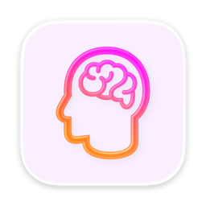

<p align="center">
  
</p>

<h1 align="center">brain.md 🧠</h1>

<p align="center">
  <strong>A fast, native Markdown notes app for macOS, with on-device AI and a built-in MCP server.</strong><br />
  Your notes stay plain <code>.md</code> files on your Mac, and your AI assistants can read them too.
</p>

<p align="center">

[](https://apple.com)
[](https://swift.org)
[](https://developer.apple.com/xcode/swiftui/)
[](https://modelcontextprotocol.io)
[](LICENSE)

</p>

```bash
brew install --cask itsreidar/tap/brain-md
```

---

## Why brain.md

- **⚡ Native and fast.** Pure Swift, SwiftUI and AppKit: instant startup, 120 FPS typing, no Electron.
- **📂 Your files, your folders.** A vault is just a folder of Markdown. Use it alongside Obsidian, VS Code or Git.
- **🤖 AI that stays on your Mac.** Summaries, chat, meeting transcripts and search by meaning, all run locally with MLX.
- **🔌 Plugs into your AI tools.** Claude Desktop, Cursor and other agents can read, search and write your notes over MCP.
- **🔒 Private by default.** Works offline. Nothing leaves your Mac unless you connect an assistant yourself.

---

## ✨ Features

### ✍️ Write

- **Live split view.** Editor and preview side by side, with synced scrolling, or either one on its own.
- **Everything Markdown can do.** GitHub Flavored Markdown with tables, task lists, callouts (`[!NOTE]`, `[!TIP]` …), definition lists, `==highlights==`, emoji shortcodes and inline HTML like `<details>`, `<kbd>` and `<mark>`.
- **Diagrams offline.** Mermaid flowcharts, sequence and state diagrams render without a network connection.
- **Code that looks good.** Syntax-highlighted code blocks styled as macOS windows, with one-click copy.
- **An editor that behaves.** Smart lists with Tab / ⇧Tab, auto-pairing, selection wrapping, and no surprise em-dashes.
- **112 themes.** Catppuccin, Tokyo Night, Dracula, Nord, Gruvbox, Solarized and many more, light and dark.
- **Images just work.** Drag them in or paste a screenshot with ⌘V; they land in your attachments folder with a relative link.
- **Export to PDF.** Crisp vector PDFs of the preview, diagrams and images included (⌘P).

### 🗂️ Organize

- **Native tabs.** ⌘-click a note, or press ⌘T. Every tab keeps its own edits, and your tabs come back next time.
- **Jump anywhere.** The Quick Switcher (⌘O) finds any note as you type.
- **See how notes connect.** A 3D brain graph of your notes, folders, links and tags (⌥⌘G).
- **Safe deletes.** ⌘⌫ or **Move to Trash** sends notes to the macOS Trash, so Finder's **Put Back** can undo it.
- **Templates.** New notes get the title format and content template you choose, with tokens like `{date}`.
- **Always in sync.** Edits made in other apps show up instantly.

### 🤖 On-device AI

Optional, and one switch in Settings turns it all off.

- **Pick your model.** Gemma 4, Qwen3.5, Ministral or Mistral, downloaded only when you choose one.
- **Rewrite, summarize, extract action items.** Results open in a review sheet, so nothing touches your note until you say so.
- **AI Chat (⇧⌘J).** Ask about the open note or anything else.
- **Skills.** Save your own prompts as Markdown notes and reuse them from the ✨ menu.
- **Meeting notes.** Record a call, get a live transcript with speakers labelled, then draft the minutes, in English, Dutch and many other languages.
- **Search by meaning.** Find the note about "budget overrun" even if it says "costs exceeded the plan", across languages.

More in [On-Device AI & Meetings](docs/local-ai.md).

### 🍎 Fits into macOS

- **Open from Finder.** Double-click any `.md` file, in your vault or not, and make Brain.md your default Markdown app.
- **Open from the terminal.** `brain notes.md` opens a note, and `brain new.md` starts one.
- **Quick Look.** Press Space in Finder for a rendered preview.

More in [Finder Integration](docs/finder-integration.md).

---

## 🔌 Connect your AI assistant (MCP)

Brain.md runs a local [Model Context Protocol](https://modelcontextprotocol.io) server, so assistants like Claude Desktop and Cursor can work with your notes.

**Claude Desktop in three steps:**

1. In Brain.md, click the **MCP** badge in the toolbar and choose **Copy Claude Desktop Config**.
2. Paste it into `~/Library/Application Support/Claude/claude_desktop_config.json`:

   ```json
   {
     "mcpServers": {
       "brain-md": { "url": "http://127.0.0.1:8765/sse" }
     }
   }
   ```

3. Restart Claude Desktop.

<details>
<summary><strong>The 16 tools assistants get</strong></summary>

| Tool              | What it does                                         | Arguments                                       |
| :---------------- | :--------------------------------------------------- | :---------------------------------------------- |
| `list_notes`      | Lists notes and folders                              | `folder` *(optional)*                           |
| `read_note`       | Reads a note's Markdown                              | `path`                                          |
| `create_note`     | Creates a note                                       | `path`, `content`                               |
| `update_note`     | Appends to or overwrites a note                      | `path`, `content`, `mode` (`overwrite`/`append`) |
| `delete_note`     | Moves a note to the macOS Trash                      | `path`                                          |
| `search_notes`    | Full-text and title search                           | `query`                                         |
| `get_vault_stats` | Note and word counts, recent activity                | none                                            |
| `move_note`       | Moves a note or folder into another folder           | `sourcePath`, `targetFolder`                    |
| `rename_note`     | Renames a note or folder                             | `path`, `newName`                               |
| `get_tags`        | All tags with counts and notes                       | `tag` *(optional)*                              |
| `get_backlinks`   | Incoming and outgoing links and tags of a note       | `path`                                          |
| `create_folder`   | Creates a folder, with any missing parent folders    | `path`                                          |
| `list_folders`    | Lists every folder, empty ones too                   | none                                            |
| `search_by_meaning` | Finds notes by meaning with the on-device model    | `query`, `limit` *(optional)*                   |
| `get_open_note`   | The note in Brain.md's front tab, unsaved edits too  | none                                            |
| `open_note`       | Opens a note in Brain.md, in a new tab by default    | `path`, `newTab` *(optional)*                   |

A read-only mode in Settings blocks every tool that changes notes. Full details in the [MCP Server docs](docs/mcp-server.md).

</details>

---

## 🚀 Install

```bash
brew install --cask itsreidar/tap/brain-md
```

Or download the DMG from the [latest release](https://github.com/ItsReidar/brain-md/releases/latest) and drag Brain.md into Applications. Requires macOS 26 (Tahoe); on-device AI needs Apple Silicon.

<details>
<summary><strong>macOS says it can't open Brain.md</strong></summary>

Brain.md is signed but not notarized by Apple, so macOS blocks the first launch (and the first launch after each upgrade). Open it once, then click **Open Anyway** in **System Settings › Privacy & Security**. Or remove the quarantine flag (no `sudo` needed):

```bash
xattr -dr com.apple.quarantine /Applications/brain-md.app
```

</details>

---

## ⌨️ Keyboard shortcuts

| Shortcut          | Action                          | Shortcut      | Action                       |
| :---------------- | :------------------------------ | :------------ | :--------------------------- |
| `⌘N`              | New note                        | `⌘⌃1` – `⌘⌃3` | Split, editor or preview     |
| `⌘T`              | New tab                         | `⇧⌘J`         | AI Chat                      |
| `⌘W`              | Close tab                       | `⌘.`          | Stop an AI answer            |
| `⌘O`              | Quick Switcher                  | `⌘B` / `⌘I`   | Bold / italic                |
| `⌘S`              | Save                            | `⌘E` / `⌥⌘C`  | Inline code / code block     |
| `⌘⌫`              | Move note to Trash              | `⌘K`          | Link                         |
| `⌘P`              | Export PDF                      | `⌥⌘1` – `⌥⌘6` | Heading 1–6                  |
| `⌥⌘G`             | Brain graph                     | `⌘,`          | Settings                     |

---

## 🛠️ Build from source

You need Xcode 26 or later with the Metal Toolchain (`xcodebuild -downloadComponent MetalToolchain`).

```bash
git clone https://github.com/ItsReidar/brain-md.git
cd brain-md
open brain-md.xcodeproj
```

Run the tests from Xcode, or from the terminal:

```bash
xcodebuild test -project brain-md.xcodeproj -scheme brain-md -destination 'platform=macOS' -only-testing:brain-mdTests
```

See [Development & Testing](docs/development-and-testing.md) and, for maintainers, [Releasing](docs/releasing.md).

---

## 📚 Documentation

| Guide | What's inside |
| :---- | :------------ |
| [Architecture](docs/architecture.md) | How the app fits together, with diagrams, concurrency and security |
| [Vault & Files](docs/vault-management.md) | Folders, auto-save, templates, attachments, Trash |
| [Editor & Markdown](docs/editor-and-markdown.md) | Syntax highlighting, tabs, Mermaid, every supported Markdown feature |
| [On-Device AI & Meetings](docs/local-ai.md) | Models, AI Chat, Skills, transcription, search by meaning |
| [MCP Server](docs/mcp-server.md) | Transports, tool schemas, connecting assistants |
| [Finder Integration](docs/finder-integration.md) | Opening files, the `brain` command, Quick Look |
| [3D Brain Graph](docs/3d-graph-view.md) | Rendering, layout and interaction |
| [Settings](docs/settings-and-customization.md) | Themes, title formats, templates |
| [Development & Testing](docs/development-and-testing.md) | Building, tests, benchmarks |
| [Releasing](docs/releasing.md) | Signing, DMG and Homebrew distribution |

---

## 📄 License

brain.md is free software under the [GNU General Public License v3.0](LICENSE).
