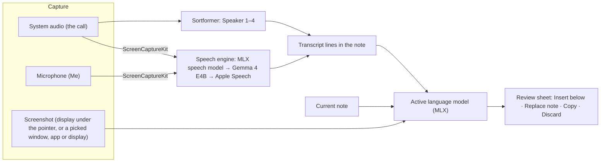

# On-Device AI & Meetings

brain-md runs language models on your Mac with [MLX](https://github.com/ml-explore/mlx-swift) for summaries, action items, rewriting, screen explanations and free-form chat, and transcribes meetings on-device with an MLX speech model, the language model itself (Gemma 4 E4B) or Apple's **SpeechAnalyzer**. You pick the models in Settings: every model is optional and downloads once. Notes, audio and screenshots never leave the Mac; the only network traffic is model downloads from Hugging Face (and Apple's speech model download per language).



## Features

| Feature | Where | What happens |
|---|---|---|
| Skills | ✨ menu, and the chat's suggestions and **Skills** menu | Your saved prompts, as Markdown files in the vault (see [Instructions & Skills](#instructions--skills)). The defaults: Summarize Note, Extract Action Items, Polish & Rewrite, List the Open Questions and Suggest a Better Title |
| Explain Screen | ✨ menu › Explain Screen | **Screen Under Pointer** captures that display (without brain-md's windows). **Choose Window, App or Display…** opens the macOS picker so you can pick exactly what to explain. The language model then explains the slide or diagram. Needs a model that sees images (all except Mistral 7B) |
| Record a meeting | 🎙 toolbar button | Live transcript lines labelled **Me** and **Speaker 1–4** (or **Them** without speaker identification) with timestamps; minutes from the language model when you stop |
| AI Chat | ✨ menu › AI Chat…, or View › AI Chat (⇧⌘J) | A conversation in its own window, optionally about the open note |

The ✨ menu also has **AI Chat…** and **Manage Skills…** (opens Settings). Until a language model is downloaded and on-device AI is turned on, it shows only **Set Up On-Device AI…**.

Model output always opens in a **review sheet** first. Nothing is written to a note until you choose Insert Below or Replace Note (which asks for confirmation). Meeting transcript lines are the exception: they are written to the open note as they're finalized, and switching notes stops the recording.

Answers are in the note's language (in chat: the language you write in). Notes longer than about 8,000 tokens (32,000 characters) are truncated with a visible marker.

## AI Chat

A separate window for asking the active language model anything, without the preset actions.

- The **note chip** under the message field (on by default) sends the open note with your message; click it to leave the note out. It's sent once and again only after you edit it, so follow-up questions stay fast.
- An empty chat offers starting points: with a note, Summarize, Open questions, Action items and a better title (sent straight away); without one, prompts you complete yourself.
- Answers render Markdown (headings, lists, task boxes, quotes, tables and highlighted code blocks). Return sends; ⌥Return adds a line.
- Each answer has **Copy** and **Insert into Note**, which appends it to the note that's open at that moment.
- **Stop** (⌘.) ends an answer early; **New Chat** clears the conversation.
- The conversation lives in memory only: it isn't saved and is gone when you quit. When the model unloads after five idle minutes, the next message reloads it and replays the last 20 exchanges so the model still remembers the conversation.
- **Context usage** shows under the message field after the first answer, as a ring and "1.7K / 131K" tokens of the model's context window (131,072 for Gemma 4 E4B, read from each model's config). The ring turns amber at 70 % and red at 90 %; hover for exact numbers and the last answer's speed. A shared note counts too (roughly 1,000 tokens per 4,000 characters). Start a new chat when it's nearly full.
- Opening the window loads and warms up the model in the background, so the first answer starts in about a quarter of a second instead of about four.

## Instructions & Skills

**Settings › Local AI & Voice › Instructions & Skills**

- **Custom Instructions** (up to 2,000 characters) are added to every request, in chat and the ✨ menu, after the built-in rules: for example "Answer in Dutch. Keep it short." In chat, edits apply from the next message.
- **Skills** are saved prompts, stored as Markdown files in the vault's `Skills` folder, so they sync with your notes and you edit them like any note. Settings lists them with **Edit** (opens the file), **New Skill**, **Show in Finder** and **Restore Defaults** (re-adds missing default skills; edited ones are kept).

A skill file:

```markdown
---
name: Translate to Dutch
description: Translates the note
icon: globe                # an SF Symbol name
show-in: [menu, chat]      # the ✨ menu, the chat window, or both
uses-note: true            # adds the open note to the prompt
order: 10                  # lower comes first
---
Translate this note into Dutch, keeping its Markdown structure.
```

The body is the prompt. With `uses-note: true` the note is appended, or placed where `{{note}}` appears; with `false` the prompt is sent on its own. Missing fields default to the file name, `sparkles`, both places, `true` and 100. A file without a body is ignored.

In the ✨ menu a skill's answer opens in the review sheet. In chat it's sent as a message shown with the skill's name; a skill that uses the note always includes it, even when the note chip is off.

The five default skills are written the first time on-device AI is used with a vault. Deleting one is permanent; use **Restore Defaults** to get it back. The `Skills` folder sits under **App Folders** in the sidebar and is left out of the 3D graph (see [Vault Management](vault-management.md#app-folders)).

## Speech engines

Each recording picks its engine when it starts, from what's installed:

1. **The speech model selected in Settings**, if it's downloaded. Fastest, and the only option with words appearing while people talk (streaming models).
2. **Otherwise the active language model, if it can hear:** Gemma 4 E4B. It reuses the model already in memory, but it's slower and shows each passage when the speaker pauses.
3. **Otherwise Apple Speech** (SpeechAnalyzer), built into macOS.

MLX engines need on-device AI turned on and Apple Silicon. Settings › Speech Recognition says which engine meetings will use, and why.

MLX engines cut each audio source into utterances at pauses (an energy detector against the room's noise floor, so no extra model). While someone speaks, the open utterance is re-transcribed about every second for live words (every 1.5 s for Parakeet, 2.5 s for Whisper); when they pause, it's transcribed once more as the final line. Utterances are cut at 12 s (15 s for Parakeet, 28 s for Whisper, 20 s for Gemma) so lines don't grow forever. Speech-model and diarizer inference runs one call at a time on the GPU.

**Speed** (M2 Pro, `MLXSpeechIntegrationTests`, three spoken sentences): with audio arriving in real time, Nemotron 3.5 Streaming 8-bit delivers each final line about 0.8 s after the speaker stops, Apple Speech about 1.3 s. Fed as fast as possible, Apple Speech is faster overall (0.4 s vs 2.4 s for 14.6 s of audio), because Nemotron also produces live words along the way.

### Speaker identification

With **Sortformer** downloaded and **Identify Speakers** on, call audio is diarized while you record: each final line from the call gets the speaker who talked most during it, as **Speaker 1–4** in the order voices are first heard. The microphone is always **Me**. It works with the MLX speech models and Gemma 4 E4B; with Apple Speech, call lines stay **Them**. If the diarizer fails, the meeting carries on without labels.

### Languages

Apple Speech uses **SpeechTranscriber**, the long-form model built for meetings, when it supports the language (English, French, German, Spanish and others), and falls back to **DictationTranscriber**, which supports more, including **Dutch** (`nl_BE` and `nl_NL`). A requested region the engines don't have maps to the language's main region (English in Belgium → `en_US`).

The Transcription Language setting applies to Apple Speech and Whisper (which otherwise might translate). Nemotron, Parakeet, Orukeet, Voxtral and Gemma detect the language themselves. Nemotron, Parakeet and Orukeet cover 25 European languages including Dutch, Voxtral 13, Whisper 99.

## Setup

**Settings › Local AI & Voice**

- **Enable on-device AI** turns the MLX models on. Turning it off unloads them and asks whether to delete their files.
- **Language Model** lists every language model with size, licence and capability bubbles (**Text**, **Images**, **Speech**, **Base**): **Download**, **Use** and delete. One is active; switching unloads the previous one.
- **Speech Recognition** lists the speech models (bubbles **Speech to Text**, and **Live** for streaming models); **No speech model** means Gemma 4 E4B or Apple Speech (see [Speech engines](#speech-engines)). **Transcription Language** defaults to the system language.
- **Speaker Identification** downloads Sortformer and turns **Identify Speakers** on or off.
- **Instructions & Skills** set custom instructions and manage skills (see above).
- **Capture Incoming System Audio** / **Capture Microphone Audio** choose the meeting sources; **Visual Diagram Comprehension** shows or hides Explain Screen.

### Permissions

| Permission | Needed for | Asked |
|---|---|---|
| Screen & System Audio Recording | Explain Screen › Screen Under Pointer, system audio in meetings | On first use, by macOS |
| Microphone | Your side of a meeting | When recording starts |

Choosing content with the picker needs no Screen Recording permission: picking is the consent. If the permission is already granted, a picked display also leaves out brain-md's own windows.

Speech recognition permission is not requested: SpeechAnalyzer transcribes on-device without it. The usage string is declared as a safeguard.

## Models

Every model is an MLX conversion on Hugging Face, defined by one entry in `Services/AI/Models/ModelCatalog.swift` (repository, pinned revision, kind, size, licence). Adding or swapping a model is one entry: the store downloads it, Settings lists it and the runtimes load it from the descriptor.

### Language models

| Model | Repository | Size | Images | Speech | Licence |
|---|---|---|---|---|---|
| Gemma 4 E4B (default) | `mlx-community/gemma-4-E4B-it-qat-4bit` | 6.8 GB | ✓ | ✓ | Apache-2.0 |
| Gemma 4 E4B Base / E2B Base | `mlx-community/gemma-4-{e4b,e2b}-4bit` | 5.2 / 3.6 GB | ✓ |  | Apache-2.0 |
| Gemma 4 12B | `mlx-community/gemma-4-12B-it-4bit` | 6.8 GB | ✓ |  | Apache-2.0 |
| Qwen3.5 9B / 4B / 2B | `mlx-community/Qwen3.5-{9B,4B,2B}-MLX-4bit` | 6.0 / 3.1 / 1.7 GB | ✓ |  | Apache-2.0 |
| Ministral 3 3B | `mlx-community/Ministral-3-3B-Instruct-2512-8bit` | 4.5 GB | ✓ |  | Apache-2.0 |
| Mistral 7B v0.3 (4-bit / 8-bit) | `mlx-community/Mistral-7B-Instruct-v0.3-{4bit,8bit}` | 4.1 / 7.7 GB |  |  | Apache-2.0 |

Vision-capable architectures load through mlx-swift-lm's VLM factory, Mistral 7B through the LLM factory. Gemma 4 E4B is the quantization-aware-trained 4-bit conversion; the "qat-mobile" export uses mixed 2/4-bit weights mlx-swift-lm can't load. The **Base** models are pretrained checkpoints, not instruction-tuned: they continue text and follow instructions loosely, so expect rougher summaries and chat. They have no chat template, so brain-md uses Gemma 4's own (`Vendor/ChatTemplates/gemma4.jinja`, from the instruct E4B at the pinned revision; the tokenizers' vocabularies are identical). A catalog entry names such a template with `fallbackChatTemplate`. Their checkpoints include the audio tower, but meetings never fall back to a base model, because it doesn't reliably transcribe on request. Gemma 4 12B's audio path (`gemma4_unified`, mlx-swift-lm#400) isn't ported, so it doesn't transcribe.

### Speech models

| Model | Repository | Size | Live words | Licence |
|---|---|---|---|---|
| Nemotron 3.5 Streaming (8-bit / full) | `mlx-community/nemotron-3.5-asr-streaming-0.6b{-8bit,}` | 0.76 / 1.3 GB | ✓ | NVIDIA Open Model License |
| Parakeet TDT v3 | `mlx-community/parakeet-tdt-0.6b-v3` | 2.5 GB |  | CC-BY-4.0 |
| Orukeet | `itsreidar/orukeet-mlx` | 1.3 GB |  | CC-BY-SA-4.0 |
| Voxtral Mini Realtime | `mlx-community/Voxtral-Mini-4B-Realtime-2602-4bit` | 3.1 GB | ✓ | Apache-2.0 |
| Whisper Large v3 Turbo / Large v3 / Small / Base | `mlx-community/whisper-*-asr-fp16` | 1.6 / 3.1 / 0.49 / 0.15 GB |  | MIT / Apache-2.0 |
| Sortformer (speaker identification) | `mlx-community/diar_streaming_sortformer_4spk-v2.1-fp16` | 0.24 GB | | NVIDIA Open Model License |

Speech models run through [mlx-audio-swift](https://github.com/Blaizzy/mlx-audio-swift). Whisper uses the `-asr-fp16` repositories because the `-mlx` ones only ship `weights.npz`, which mlx-audio-swift doesn't load. mlx-audio-swift's streaming sessions aren't public in 0.1.5, so live words come from re-transcribing the open utterance (see [Speech engines](#speech-engines)).

**Orukeet** (Oruk AI's fine-tune of Parakeet TDT v3, CC-BY-SA-4.0) had no MLX build, so `itsreidar/orukeet-mlx` is a conversion made with `scripts/models/convert_orukeet.py`. The script renames the Transformers export's tensors to the MLX Parakeet layout, checks all 697 names and shapes against `parakeet-tdt-0.6b-v3`, and writes a float16 model with the original licence and attribution; it loads with engine `parakeet`. `uv run scripts/models/convert_orukeet.py --check-mapping` verifies the mapping from file headers only; without the flag it downloads the 2.5 GB source.

### Gemma 4 audio

mlx-swift-lm 3.32.3 drops Gemma 4's `audio_tower` weights. brain-md carries an app-local copy of the Gemma 4 model with the audio encoder and log-mel features from [ml-explore/mlx-swift-lm#392](https://github.com/ml-explore/mlx-swift-lm/pull/392) (MIT) in `Services/AI/Vendor/Gemma4Audio/`, registered over the package's `gemma4` type at load. Remove it when mlx-swift-lm ships Gemma 4 audio (`TODO` in `BrainGemma4Registration.swift`).

### Download, storage and memory

- **Pinned revisions:** every download is pinned to a commit. swift-transformers still depends on yyjson 0.12.0 ([GHSA-f4vc-345x-4mvm](https://github.com/advisories/GHSA-f4vc-345x-4mvm)), which parses the models' JSON files, so only known file sets are ever parsed. Unpin once [huggingface/swift-transformers#392](https://github.com/huggingface/swift-transformers/pull/392) ships (`TODO` in `ModelCatalog`).
- **Storage:** `~/Library/Application Support/brain-md/models`, in the Hugging Face cache layout. Speech models and Sortformer are also linked under `models/mlx-audio/`, where mlx-audio-swift looks, so they load offline at the pinned revision. That folder is real with one link per file: when mlx-audio can't list a model folder it deletes the model's cache entry, which would be the downloaded snapshot.
- **Memory:** loading a language model checks that about 1.2× its size is free and fails with a clear message otherwise. It loads on first use and unloads after five idle minutes. A speech model loads when a recording starts.
- **Speed** (Gemma 4 E4B, M2 Pro, `LanguageModelBenchmarkTests`): about 31 tokens/s generated and 550–730 tokens/s of prompt read; loading takes about 4 s. Follow-up chat messages reuse the conversation's KV cache (about 0.2 s to the first word). mlx-swift-lm 3.32.3's Gemma 4 processor attaches an all-ones attention mask to every prompt, which disables that reuse; `TextMaskDroppingProcessor` in `HubAdapters.swift` drops it for text-only prompts.
- **Apple Silicon only:** MLX runs on Apple Silicon GPUs; on an Intel Mac only Apple Speech is available.

## Code map

| File | Role |
|---|---|
| `Services/AI/Models/ModelCatalog.swift` | Every downloadable model: repository, pinned revision, kind, size, licence |
| `Services/AI/Models/ModelStore.swift` | Per-model download, verification, deletion and the mlx-audio link |
| `Services/AI/Models/ModelSelection.swift` | The chosen language and speech models and the speaker setting |
| `Services/AI/Models/LanguageModelRuntime.swift` | Loads and unloads the active language model (VLM or LLM factory) |
| `Services/AI/Vendor/Gemma4Audio/` | Gemma 4 with audio input, ported from mlx-swift-lm#392 |
| `Services/AI/HubAdapters.swift` | Bridges swift-huggingface and swift-transformers to mlx-swift-lm (replaces the MLXHuggingFace macros); drops Gemma 4's no-op attention mask so chat turns reuse the KV cache |
| `Services/AI/LanguageModelService.swift` | Prompts and streaming generation, prewarm, idle unload |
| `Services/AI/Skills.swift` | Skill file parsing, prompts, the vault's skill library and default skills |
| `Services/AI/AssistantChat.swift` | Chat state, note context, session rebuild from history, context usage |
| `Services/AI/VisualCaptureService.swift` | Full-resolution screenshot of the display under the pointer, or of a window, app or display chosen in the system picker |
| `Services/AI/AudioCaptureService.swift` | ScreenCaptureKit system audio + microphone, levels |
| `Services/AI/Speech/SpeechEngine.swift` | Which engine a recording uses, and the Settings explanation |
| `Services/AI/Speech/SpeechRecognizer.swift` | The engine protocol, the factory and 16 kHz resampling |
| `Services/AI/Speech/UtteranceSegmenter.swift` | Cuts audio into utterances with live-word windows |
| `Services/AI/Speech/WindowedTranscription.swift` | The pipeline the MLX engines share: per source, segment, transcribe, label speakers |
| `Services/AI/Speech/MLXSpeechRecognizer.swift` | Speech models through mlx-audio-swift |
| `Services/AI/Speech/LanguageModelSpeechRecognizer.swift` | Gemma 4 E4B transcribing audio |
| `Services/AI/Speech/AppleSpeechRecognizer.swift` | Apple SpeechAnalyzer: engine and locale choice, one analyzer per source, language assets |
| `Services/AI/Speech/SpeakerDiarizer.swift` | Sortformer over call audio, the speaker timeline, the shared GPU gate |
| `Services/AI/MeetingRecorder.swift` | Recording session: capture → transcript lines → minutes |
| `Views/AIResultSheet.swift` | Review sheet |
| `Views/AssistantChatView.swift` | AI Chat window |
| `Views/ModelSettingsViews.swift` | Model rows in Settings |
| `Views/MeetingLiveOverlay.swift` | Live levels and partial transcript while recording |

## Testing

Unit tests cover prompts, the catalog, engine choice (all fallback cases), utterance cutting, speaker timelines and labels, model-file verification, audio conversion and levels, transcript formatting and coordinate conversion. Tests that need real models, a speech engine or the network are opt-in:

| Flag (`TEST_RUNNER_` prefix) | Suite | Needs |
|---|---|---|
| `BRAINMD_MODEL_INTEGRATION=1` | Gemma 4 E4B chat, KV-cache reuse, images, audio | Gemma 4 E4B downloaded |
| `BRAINMD_SPEECH_INTEGRATION=1` | Apple Speech in English and Dutch | Ellen and Xander voices; downloads Apple's Dutch model once |
| `BRAINMD_MLX_SPEECH_INTEGRATION=1` | Nemotron (English with live words, Dutch), Sortformer telling two voices apart, Gemma through the meeting pipeline, Nemotron vs Apple Speech latency | Downloads Nemotron 8-bit (0.76 GB) and Sortformer (0.24 GB) if missing |
| `BRAINMD_QWEN_INTEGRATION=1` | Qwen3.5 2B chat, follow-up turn and image | Downloads Qwen3.5 2B (1.75 GB) if missing |
| `BRAINMD_ORUKEET_DIR=<folder>` | A converted Orukeet transcribes English and Dutch before it's uploaded | Output of `convert_orukeet.py` |
| `BRAINMD_CATALOG_CHECK=1` | Every catalog entry exists at its revision with safetensors and a supported `model_type` | Network; reads file lists and `config.json` only |
| `BRAINMD_MODEL_BENCHMARK=1` | Language model speed | Gemma 4 E4B downloaded |

```bash
TEST_RUNNER_BRAINMD_MLX_SPEECH_INTEGRATION=1 TEST_RUNNER_BRAINMD_BENCHMARK_OUT=/tmp/brainmd-bench.txt xcodebuild test -project brain-md.xcodeproj -scheme brain-md -destination 'platform=macOS' -parallel-testing-enabled NO -only-testing:brain-mdTests/MLXSpeechIntegrationTests
```

Run real-model suites with parallel testing off, so only one copy of a model loads. Speech tests synthesize sentences with `say` (Samantha and Daniel in English, Ellen and Xander in Dutch). Benchmark results go to `BRAINMD_BENCHMARK_OUT`, because Swift Testing doesn't capture `print`.

Not automated, because they need macOS permission prompts or system UI: a real screen capture, the content picker and a real call recording.
